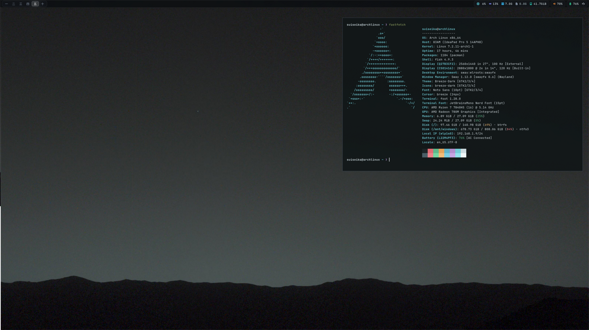

# cfgs

Personal configuration dotfiles.



### Modern SwayFX Desktop Setup
- **Window Manager**: `sway/` (SwayFX with frosted blur, custom shadows, and dual-monitor support)
- **Bar**: `waybar/` (Frosted slate status bar with grouped hardware, audio, and system capsules)
- **Application Launcher**: `rofi/` (Mars Twilight theme, optimized ~50ms launch, cached drun mode)
- **Notification Daemon**: `swaync/` (Control center and notification styling)
- **OSD**: `swayosd/` (Volume, brightness, and caps lock overlays)
- **Terminal**: `foot/` (Minimal, fast Wayland terminal with matching slate palette)
- **File Manager**: `yazi/` (Clean sharp corners and dark theme)
- **Browser Flags**: `helium/` (Smooth Wayland video decoding & background throttling prevention)
- **Desktop Helpers**: `scripts/` (Sway launcher, audio toggle, power menu, wallpaper manager)

---

### Installation on Arch Linux

Clone the repository and run the automated installer:

```bash
git clone https://github.com/suichanwa/cfgs.git
cd cfgs
chmod +x install.sh
./install.sh
```

The script will:
1. Install all necessary official packages (`swayfx`, `waybar`, `rofi`, `foot`, `yazi`, `pamixer`, fonts, icons, etc.) via `pacman`.
2. Check for an AUR helper (`yay`/`paru`) to optionally install SwayNC and SwayOSD.
3. Automatically back up your existing configurations into `~/.config_backup_<timestamp>`.
4. Deploy the configuration files and helper scripts with proper permissions.
5. Apply system dark theme defaults.
